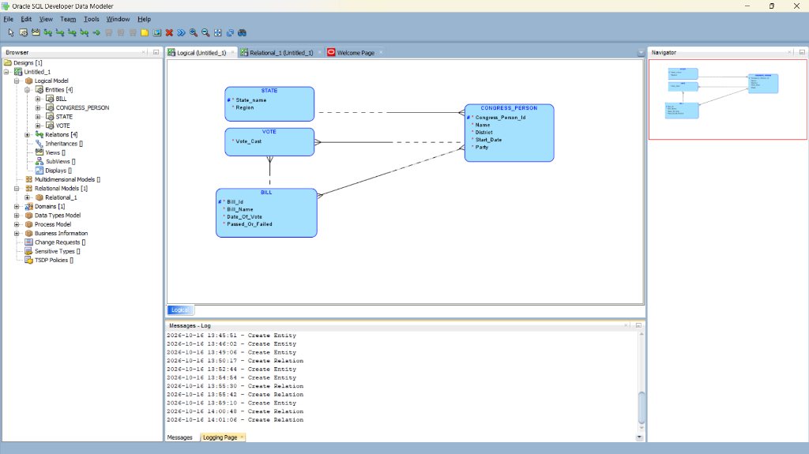

# Laporan & Implementasi Ujian Tengah Semester (UTS)
## Mata Kuliah: Sistem Basis Data

**Dosen Pengampu**: Pak Rizal Broer, M.Kom (`rizalbroer@uinjkt.ac.id`)  
**Nama Mahasiswa**: Danuardi Saputro  
**Kelas**: 3D  
**Repositori GitHub**: [https://github.com/dnnuuyzzo/UTS_SBD_Danuardi-Saputro_3D](https://github.com/dnnuuyzzo/UTS_SBD_Danuardi-Saputro_3D)

---

## Daftar Isi
1. [Aturan & Ketentuan Pengerjaan](#1-aturan--ketentuan-pengerjaan)
2. [Alat & Teknologi yang Digunakan](#2-alat--teknologi-yang-digunakan)
3. [Soal 3.21: U.S. House of Representatives Voting Database (Bobot 25%)](#3-soal-321-us-house-of-representatives-voting-database-bobot-25)
4. [Soal 3.34: CONFERENCE_REVIEW Database (Bobot 35%)](#4-soal-334-conferencereview-database-bobot-35)
5. [Soal 3.35: AIRLINE Database System (Figure 3.21) (Bobot 40%)](#5-soal-335-airline-database-system-figure-321-bobot-40)
6. [Langkah-Langkah Implementasi pada Oracle SQL Developer Data Modeler](#6-langkah-langkah-implementasi-pada-oracle-sql-developer-data-modeler)
7. [Eksekusi & Dump DDL pada PostgreSQL](#7-eksekusi--dump-ddl-pada-postgresql)
8. [Struktur Repositori](#8-struktur-repositori)

---

## 1. Aturan & Ketentuan Pengerjaan
Sesuai instruksi soal:
- Pengerjaan dilakukan mandiri menggunakan pemodelan data konseptual dan fisikal.
- Dokumentasi mencakup setiap tahapan menggunakan gambar/tangkapan layar (*screenshot*) proses disertai deskripsi penjelasannya.
- Menggunakan software **Oracle SQL Developer Data Modeler** untuk Logical Model dan Physical/Relational Model.
- Menghasilkan DDL (*Data Definition Language*) yang di-*dump* dan dijalankan pada database **PostgreSQL**.
- Menghubungkan pelaporan ke GitHub dengan menambahkan dosen pengampu (`rizalbroer@uinjkt.ac.id`) sebagai kolaborator repositori.

---

## 2. Alat & Teknologi yang Digunakan
- **Oracle SQL Developer Data Modeler (v24.3)**: Untuk merancang *Entity-Relationship Diagram* (ERD), *Logical Model*, dan melakukan transformasi *Engineer to Relational (Physical) Model*.
- **PostgreSQL 18 & pgAdmin 4**: Untuk eksekusi script DDL, manajemen skema relasional, dan verifikasi integritas data (*constraints*).
- **Git & GitHub**: Untuk version control, kolaborasi tim, dan dokumentasi terbuka.

---

## 3. Soal 3.21: U.S. House of Representatives Voting Database (Bobot 25%)

### A. Deskripsi Kasus
Merancang skema ER untuk mencatat informasi voting pada sidang DPR AS (*U.S. House of Representatives*) selama periode kongres dua tahunan. Sistem mencatat:
- **STATE**: Nama negara bagian unik (misal: Texas, California) dan region geografis (`Northeast`, `Midwest`, `Southeast`, `Southwest`, `West`).
- **CONGRESS_PERSON**: Anggota DPR yang memiliki nama, distrik yang diwakili, tanggal pertama terpilih (`Start_date`), dan partai politik (`Republican`, `Democrat`, `Independent`, `Other`).
- **BILL**: RUU yang diusulkan, memiliki nama RUU unik, tanggal pemungutan suara, status kelulusan (`Yes`, `No`), dan sponsor (anggota DPR yang mengusulkan).
- **VOTE**: Suara tiap anggota DPR terhadap masing-masing RUU dengan pilihan (`Yes`, `No`, `Abstain`, `Absent`).

### B. Kamus Data & Struktur Entitas
| Entitas | Atribut | Tipe Data | Keterangan / Constraint |
| :--- | :--- | :--- | :--- |
| **STATE** | `state_name` | VARCHAR(50) | **Primary Key** |
| | `region` | VARCHAR(20) | CHECK (`Northeast`, `Midwest`, `Southeast`, `Southwest`, `West`) |
| **CONGRESS_PERSON** | `congress_person_id` | SERIAL / NUMERIC | **Primary Key** |
| | `name` | VARCHAR(100) | Mandatory |
| | `state_name` | VARCHAR(50) | **Foreign Key** -> `STATE(state_name)` |
| | `district` | INT | Mandatory |
| | `start_date` | DATE | Mandatory |
| | `party` | VARCHAR(20) | CHECK (`Republican`, `Democrat`, `Independent`, `Other`) |
| **BILL** | `bill_id` | SERIAL / NUMERIC | **Primary Key** |
| | `bill_name` | VARCHAR(150) | Unique, Mandatory |
| | `date_of_vote` | DATE | Mandatory |
| | `passed_or_failed` | VARCHAR(5) | CHECK (`Yes`, `No`) |
| **BILL_SPONSOR** | `bill_id` | INT | **Composite PK**, **FK** -> `BILL` |
| | `congress_person_id` | INT | **Composite PK**, **FK** -> `CONGRESS_PERSON` |
| **VOTE** | `congress_person_id` | INT | **Composite PK**, **FK** -> `CONGRESS_PERSON` |
| | `bill_id` | INT | **Composite PK**, **FK** -> `BILL` |
| | `vote_cast` | VARCHAR(10) | CHECK (`Yes`, `No`, `Abstain`, `Absent`) |

### C. Dokumentasi Diagram di Oracle Data Modeler


### D. File DDL PostgreSQL
Script DDL lengkap tersedia di: [`sql/01_Soal_3_21_Congress_Votes.sql`](sql/01_Soal_3_21_Congress_Votes.sql).

---

## 4. Soal 3.34: CONFERENCE_REVIEW Database (Bobot 35%)

### A. Deskripsi Kasus
Basis data untuk konferensi ilmiah di mana peneliti mengirimkan karya ilmiah (*paper*) untuk ditinjau oleh reviewer:
- **AUTHOR**: Diidentifikasi unik oleh `author_email`, memiliki nama depan dan belakang.
- **PAPER**: Diidentifikasi oleh `paper_id` unik, judul (*title*), abstrak (*abstract*), nama file elektronik (*file_name*), dan memiliki tepat 1 penulis kontak (*contact author*).
- **PAPER_AUTHOR**: Relasi banyak-ke-banyak antara Paper dan Author yang mencatat urutan penulis (*author_order*).
- **REVIEWER**: Diidentifikasi oleh `reviewer_email`, nama, nomor telepon, afiliasi instansi, dan topik minat (*topics of interest*).
- **REVIEW_ASSIGNMENT**: Relasi penugasan di mana setiap paper ditugaskan ke 2 hingga 4 reviewer. Setiap reviewer memberikan nilai (skala 1-10) untuk:
  * Technical Merit (1-10)
  * Readability (1-10)
  * Originality (1-10)
  * Relevance (1-10)
  * Overall Recommendation (`Strong Accept`, `Accept`, `Weak Accept`, dll.)
  * Komentar tertulis: *Committee Comments* (khusus panitia) dan *Author Feedback*.

### B. Kamus Data & Struktur Entitas
| Entitas | Atribut | Tipe Data | Keterangan / Constraint |
| :--- | :--- | :--- | :--- |
| **AUTHOR** | `author_email` | VARCHAR(100) | **Primary Key** |
| | `first_name`, `last_name` | VARCHAR(50) | Mandatory |
| **PAPER** | `paper_id` | SERIAL / NUMERIC | **Primary Key** |
| | `title` | VARCHAR(255) | Mandatory |
| | `abstract` | TEXT | Mandatory |
| | `file_name` | VARCHAR(255) | Mandatory |
| | `contact_author_email` | VARCHAR(100) | **Foreign Key** -> `AUTHOR(author_email)` |
| **PAPER_AUTHOR** | `paper_id`, `author_email`| INT, VARCHAR | **Composite Primary Key**, Foreign Keys |
| | `author_order` | INT | Urutan penulis (1, 2, ...) |
| **REVIEWER** | `reviewer_email` | VARCHAR(100) | **Primary Key** |
| | `first_name`, `last_name` | VARCHAR(50) | Mandatory |
| | `phone_number`, `affiliation` | VARCHAR | Informasi kontak reviewer |
| **REVIEWER_TOPIC** | `reviewer_email`, `topic` | VARCHAR | **Composite PK**, Atribut bernilai banyak |
| **REVIEW_ASSIGNMENT** | `paper_id`, `reviewer_email`| INT, VARCHAR | **Composite Primary Key**, Foreign Keys |
| | `technical_merit` | INT | CHECK (1 s.d 10) |
| | `readability` | INT | CHECK (1 s.d 10) |
| | `originality` | INT | CHECK (1 s.d 10) |
| | `relevance` | INT | CHECK (1 s.d 10) |
| | `overall_recommendation` | VARCHAR(30) | Rekomendasi akhir |
| | `committee_comments` | TEXT | Catatan untuk panitia |
| | `author_feedback` | TEXT | Ulasan untuk penulis |

### C. File DDL PostgreSQL
Script DDL lengkap tersedia di: [`sql/02_Soal_3_34_Conference_Review.sql`](sql/02_Soal_3_34_Conference_Review.sql).

---

## 5. Soal 3.35: AIRLINE Database System (Figure 3.21) (Bobot 40%)

### A. Deskripsi Kasus
Implementasi menyeluruh dari skema basis data penerbangan komersial berdasarkan Gambar 3.21 pada buku teks Elmasri:
- **AIRPORT**: `Airport_Code` (PK), `Name`, `City`, `State`.
- **AIRPLANE_TYPE**: `Type_Name` (PK), `Max_Seats`, `Company`.
- **CAN_LAND**: Relasi M:N antara jenis pesawat dan bandara yang memiliki landasan pacu yang mendukung tipe pesawat tersebut.
- **AIRPLANE**: Unit pesawat fisik dengan `Airplane_Id` (PK), `Total_No_Of_Seats`, terhubung ke `AIRPLANE_TYPE`.
- **FLIGHT**: Jadwal rute penerbangan dengan `Flight_Number` (PK), `Airline`, `Weekdays`.
- **FARE**: Tarif harga penerbangan berdasarkan kode tarif (`fare_code`), `amount`, dan `restrictions`.
- **FLIGHT_LEG**: Segmen penerbangan tanpa transit dengan nomor segmen `leg_no`, bandara keberangkatan, dan bandara kedatangan terjadwal.
- **LEG_INSTANCE**: Kejadian nyata dari segmen penerbangan pada tanggal tertentu (`flight_date`), mencatat waktu aktual, pesawat yang ditugaskan, dan sisa kursi tersedia.
- **SEAT_RESERVATION**: Pencatatan pemesanan kursi oleh penumpang dengan `Seat_No`, `Customer_Name`, dan `Customer_Phone`.

### B. File DDL PostgreSQL
Script DDL lengkap tersedia di: [`sql/03_Soal_3_35_Airline_Database.sql`](sql/03_Soal_3_35_Airline_Database.sql).

---

## 6. Langkah-Langkah Implementasi pada Oracle SQL Developer Data Modeler

1. **Pembuatan Logical Model**:
   - Membuka Oracle Data Modeler, memilih tab *Logical*.
   - Menggunakan tool *New Entity* untuk mendefinisikan entitas beserta atribut, tipe data logical, mandatory flags, dan Primary UID (`#`).
   - Menghubungkan relasi menggunakan *1:N Relation* dan *M:N Relation*.
2. **Transformasi ke Relational (Physical) Model**:
   - Menekan tombol **Engineer to Relational Model** (`Ctrl + F4`).
   - Memilih mapping dan mengklik **Engineer**.
   - Foreign Key dan tabel penghubung (*associative tables*) secara otomatis dikonstruksi.
3. **Ekspor DDL (Data Definition Language)**:
   - Mengklik ikon **DDL** pada model relasional.
   - Memilih platform target **PostgreSQL**.
   - Meng-generate script SQL `CREATE TABLE`, `PRIMARY KEY`, `FOREIGN KEY`, dan `CONSTRAINT`.

---

## 7. Eksekusi & Dump DDL pada PostgreSQL

Semua skrip DDL telah diuji dan divalidasi pada PostgreSQL 18:
```sql
-- Membuat database tugas
CREATE DATABASE uts_sbd;

-- Menjalankan masing-masing file skrip DDL:
-- 1. sql/01_Soal_3_21_Congress_Votes.sql
-- 2. sql/02_Soal_3_34_Conference_Review.sql
-- 3. sql/03_Soal_3_35_Airline_Database.sql
```
Verifikasi tabel yang terbentuk dilakukan dengan perintah:
```sql
SELECT table_name 
FROM information_schema.tables 
WHERE table_schema = 'public' 
ORDER BY table_name;
```

---

## 8. Struktur Repositori
```text
UTS_SBD_Danuardi-Saputro_3D/
├── README.md                                # Laporan teknis utama
├── screenshots/                             # Dokumentasi tangkapan layar proses
│   └── 01_Soal_3_21_Logical_Model.png
└── sql/                                     # Seluruh script DDL PostgreSQL
    ├── 01_Soal_3_21_Congress_Votes.sql
    ├── 02_Soal_3_34_Conference_Review.sql
    └── 03_Soal_3_35_Airline_Database.sql
```
